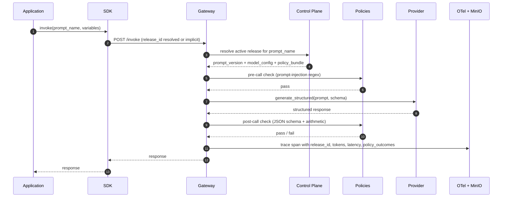
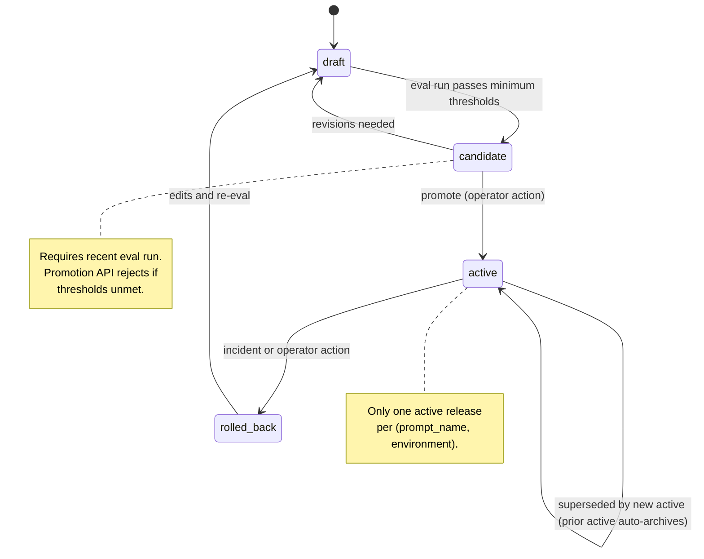

# Architecture

## Four planes

ReleasePlane decomposes into four planes per `Project_Description.txt > 3.4 High-Level Architecture`.

- **Control plane.** Stores versioned prompt definitions, prompt versions, model configs, policy bundles, and releases. Owns the release state machine. FastAPI + Postgres.
- **Execution plane.** Receives application requests, resolves the active release, calls the configured provider via the adapter Protocol, applies pre and post policies, emits traces. FastAPI gateway.
- **Ingestion.** Eval datasets (PDF generator + ground-truth JSON), eval runs, eval results. Postgres for metadata; MinIO for raw artifacts.
- **Observability.** OTel collector, Jaeger for traces, Prometheus + Grafana for metrics. `releaseplane.release_id` stamped on every span.

## Request flow



### Invoke (as built, Phase 3)

`POST /invoke` takes `prompt_name`, `variables`, and an optional `release_id`
override. The gateway resolves the release through the control-plane HTTP API
(`GET /releases/active?prompt_name=...`, or `GET /releases/{id}/resolved` for an
override), which returns the prompt version, its variable and output schemas, and
the model config in one response. The gateway validates the variables against the
version's `variables_schema_json`, substitutes `{{ name }}` placeholders in the
developer prompt, and calls the provider's `generate_structured`. The structured
object is returned with metadata: release_id, prompt_version_id, model, token
counts, latency, and a cost estimate.

Resolution reads the registry over HTTP rather than the shared database, so the
execution plane stays decoupled from the control-plane schema (decision
D-RESOLVE). The cost is one extra hop and a control-plane-down failure mode,
surfaced as 503. Templating is a minimal `{{ var }}` substitution validated by
the version's variable schema (decision D-RENDER); an unprovided placeholder
fails loud rather than rendering empty.

The pre-call and post-call policy checks shown in the diagram landed in Phase 5
(below). Full request/response archival to MinIO is still deferred (decision
D-ARCHIVE); the gateway records span metadata and a token and cost summary, not the
payload.

### Routing, providers, and policy (as built, Phase 5)

Phase 5 makes `/invoke` a real control-plane request rather than a single resolve
and call:

- **Resolution** also returns the resolved policy bundle and the model config's
  `provider`, so the gateway carries the rules it will apply and the adapter it will
  pick (decision D-POLICY-RESOLVE, the same one-hop pattern as D-RESOLVE).
- **Routing** evaluates the use case's routing rules against a signal built from the
  request (the input length on `invoice_pdf_text`, an optional caller `routing_hint`,
  and the use case). A restricted JSON predicate per rule is matched by a pure
  deterministic matcher, first match by priority, else fallthrough to the release's
  own model config (ADR 0005). A pinned `release_id` never routes, which is the
  eval runner's path.
- **Provider selection** resolves the chosen config's `provider` to an adapter
  through a registry (Claude, OpenAI, or the offline dummy). `GATEWAY_PROVIDER`, when
  set, force-overrides the serving provider (the dev stack pins `dummy` for zero
  spend); unset selects by the config (ADR 0007).
- **Policy engine** applies the bundle's checks: prompt-injection regex on the input
  (pre-call), then schema validity and arithmetic consistency on the output
  (post-call). The arithmetic check imports the same neutral predicate the eval
  scorer uses (ADR 0004, ADR 0006). A failure emits a `policy_event` and sets
  `policy_status` (`passed` / `monitored` / `failed`, by the bundle severity mode).
  v1 never transforms the output: the object is identical between monitor and
  enforce, only the metadata differs.

The span gains the routing signal, the matched rule, the serving provider, the
request id, and the policy status; two Prometheus counters
(`gateway_routing_decisions_total`, `gateway_policy_events_total`) back the routing
and policy Grafana panels.

### Spans (as built, Phase 3)

Every `/invoke` wraps the provider call in a `gateway.invoke` span carrying the
GenAI semantic-convention attributes and the release identity:

```
gen_ai.system                  provider name (claude | openai | dummy)
gen_ai.request.model           resolved model name
gen_ai.usage.input_tokens      prompt tokens
gen_ai.usage.output_tokens     completion tokens
gen_ai.response.finish_reason  stop reason
releaseplane.release_id        the audit key (releases.id)
releaseplane.prompt_version_id resolved prompt version
releaseplane.use_case          prompt definition use_case
releaseplane.cost_estimate_usd derived from model_config cost_per_mtok_*
```

`releaseplane.release_id` is the audit key: it ties any traced call back to the
exact release, prompt version, model config, and policy bundle in the registry.
The trace is now demonstrated end to end in Jaeger against the dev stack, which
closes the Phase 1 item where the span was wired but never shown in the UI. The
gateway also exports Prometheus metrics (`gateway_invoke_requests_total`,
`gateway_invoke_latency_seconds`) scraped directly by the dev-stack Prometheus,
with a Grafana dashboard for request rate, latency quantiles, and error rate by
provider.

## Release lifecycle



The `canary` state is reserved in the data model (`releases.stage` enum includes it) but no traffic-split logic is wired at v1.

### Promotion (as built)

`POST /releases/{id}/promote` advances a release one hop along the forward path
(draft to candidate to active). Each call enforces the structural rules: a legal
forward transition must exist (promoting a release already at active, or at
rolled_back or canary, is rejected with 409), the release must reference a valid
model config, and the reference bundle stays immutable so only the stage moves.
Entering active stamps `activated_at` and archives the prior active release for
the same prompt.

The eval gate from `docs/EVALUATION.md` is a single seam, `eval_gate_ok`, that the
promote endpoint calls. It looks up the most recent eval run for the release and blocks
unless that run succeeded, finished within `EVAL_STALENESS_HOURS`, and met the Tier-1
and Tier-2 thresholds. `EVAL_GATE_ENFORCED` defaults on; turning it off returns a
bypass result rather than changing any other behavior. Filling the gate touched only
that function body, not the state machine and not the endpoint, which is what the seam
was for.

The backward transitions in the diagram (candidate to draft, active to rolled_back,
rolled_back to draft) are modeled in the transition table for a future demotion or
rollback endpoint; the promote endpoint walks the forward path only.

## Data model (control plane)

```
prompt_definitions    (id, name, team, use_case, created_at)
prompt_versions       (id, prompt_id, version, system_prompt, developer_prompt,
                       variables_schema_json, output_schema_json, tool_schema_json,
                       status, checksum, created_by, created_at)
model_configs         (id, name, provider, model_name, model_version_pin,
                       temperature, max_tokens, timeout_ms, tool_mode, active,
                       cost_per_mtok_input_usd, cost_per_mtok_output_usd)
policy_bundles        (id, name, version, rules_json, severity_mode)
routing_rules         (id, use_case, predicate_json, target_model_config_id,
                       priority, created_at)
releases              (id, prompt_version_id, model_config_id, policy_bundle_id,
                       stage, rollout_percent, created_at, activated_at, archived_at)
```

### As built (Phase 2)

Phase 2 realizes these tables as SQLAlchemy 2.0 models with an Alembic migration.
Notes on the realized shapes:

- Primary keys are UUIDs (`gen_random_uuid()` server default). `releases.id` is
  the audit key stamped on every span as `releaseplane.release_id`.
- `prompt_versions.checksum` is a sha256 over a canonical JSON encoding of the
  system prompt, developer prompt, and the three schema documents, computed once
  on create. The `*_schema_json` columns and `policy_bundles.rules_json` are
  Postgres JSONB.
- `releases.stage` is a Postgres enum (`release_stage`) with values draft,
  candidate, active, rolled_back, canary.
- `model_configs` carries three columns beyond the original sketch: `name`,
  `cost_per_mtok_input_usd`, and `cost_per_mtok_output_usd`. The seed file
  `infra/model_configs/v1_default.yaml` and the cost probe both need them, so
  they are stored rather than dropped on load.
- Uniqueness: `prompt_definitions.name`, `(prompt_id, version)` on
  `prompt_versions`, `(name, version)` on `policy_bundles`, and
  `model_configs.name`.
- The "one active release per (prompt_name, environment)" rule has no
  `environment` column in the locked table, so Phase 2 enforces one active
  release per prompt. The locked `releases` table also has no `prompt_id`, so the
  promote service resolves the prompt through the prompt version and stamps
  `archived_at` on the prior active release. A per-environment dimension waits on
  an `environment` column being added.
- The one-active invariant assumes promotions are serialized. Two concurrent
  promotions of different releases for the same prompt could each archive the
  other's prior active and leave two active rows. Phase 5 wires the fix: a
  prompt-scoped advisory lock (`pg_advisory_xact_lock` keyed on the prompt id)
  around the archive-and-activate step, covered by a concurrent-promote test that
  asserts exactly one active release remains.
- Phase 5 adds `routing_rules` (Alembic `0003`): a restricted predicate stored as
  JSONB, a `target_model_config_id` foreign key, and a `priority`. The predicate is
  validated by `RoutingRulePredicate` on create (ADR 0005); the gateway evaluates it
  on `/invoke` only.

## Data model (ingestion / eval)

```
eval_datasets         (id, name, domain, source, row_count, generator_seed)
eval_cases            (id, dataset_id, input_path, expected_json, tier, metadata_json)
eval_runs             (id, release_id, dataset_id, started_at, finished_at, status)
eval_results          (id, run_id, case_id, metric_name, metric_value, pass_fail, notes)
policy_events         (id, request_id, rule_id, outcome, detail_json, created_at)
```

### As built (Phase 4)

Phase 4 realizes the four `eval_*` tables as SQLAlchemy 2.0 models with Alembic
migration `0002`. Phase 5 adds `policy_events` (Alembic `0004`): the gateway writes
one row per policy-check failure on `/invoke` through `POST /policy-events`.
`request_id` correlates a request's failures; `rule_id` holds the check name
(prompt_injection, schema_validity, arithmetic_consistency), not a routing-rule
foreign key, since policy events come from the policy bundle. Notes on the realized
`eval_*` shapes:

- Primary keys are UUIDs (`gen_random_uuid()` server default), as in the control
  tables. `eval_runs.status` is a Postgres enum (`eval_run_status`) with values
  running, succeeded, failed, created and dropped explicitly in the migration so
  `downgrade base` leaves no orphaned type.
- `eval_cases` carries one column beyond the sketch: `input_text`. `input_path`
  keeps the dataset-relative source artifact (e.g. `case_14.pdf`) for provenance,
  while `input_text` holds the perfect-OCR rendering the runner feeds to the
  gateway as `invoice_pdf_text`; the runner needs the text inline rather than a
  path to re-read. Unique `(dataset_id, input_path)` makes the loader idempotent.
- `eval_runs` carries one column beyond the sketch: `summary_json`. It holds the
  per-tier, per-metric pass rates computed at finish time so the promotion gate
  enforces the Tier-1/Tier-2 thresholds without re-aggregating the per-case rows.
  It is nullable while a run is in flight.
- `eval_results` grain is (run, case, metric) per the column list, so a 30-case
  run over the three metrics writes 90 rows. `metric_value` is the numeric score
  (1.0/0.0 for the binary v1 metrics), `pass_fail` is the gating boolean, and
  `notes` is JSONB holding the scorer's per-case detail.
- `eval_datasets` is unique by `name`, so reloading a dataset is idempotent.

## Migrations

Alembic drives the schema. The async engine cannot run the migration context
directly, so `control-plane/alembic/env.py` opens an async connection and runs
the migrations through `connection.run_sync`. The database URL and the
secret-file password resolve the same way the app resolves them, so the commands
need no configuration beyond `DATABASE_URL` (and `DATABASE_PASSWORD_FILE` when
the password comes from a mounted secret).

Run from the `control-plane` directory:

```
uv run alembic upgrade head     # create all tables and the two enum types
uv run alembic downgrade base   # drop them cleanly, including the enum types
```

`0001` creates and drops the `release_stage` enum explicitly and `0002` does the
same for `eval_run_status`, so `downgrade base` leaves no orphaned type behind.
CI runs the integration tests against a Postgres service; the test schema is
built from the same models.

CI builds that test schema with `Base.metadata.create_all` for the test session,
which on its own would let a model change that lacks a matching migration pass CI
while breaking a real `alembic upgrade`. Phase 4 closes that gap: CI runs
`alembic upgrade head` against the service Postgres and then `alembic check`,
which exits non-zero if autogenerate would emit any operation. A model without a
matching migration now fails CI. The migration step runs before the test suite,
so `create_all` (checkfirst) is a no-op against the already-migrated schema.

## Eval runner and gate (Phase 4)

The eval harness keeps the planes separated. The `eval_*` tables and the gate
live in the control plane; the runner and the metric scorers live in the evals
package; neither plane imports the other's internals.

- The runner (`releaseplane_evals.runner.run_eval`, driven by the evals CLI)
  resolves the release, reads the dataset cases, and for each case calls the
  gateway `POST /invoke` (decision D-EVAL-CALL: it scores the real resolve ->
  render -> provider path). It scores the output with the three pure metric
  scorers and writes results back through the control-plane API.
- Persistence is two calls: `POST /eval-runs` opens a run in `running`, then
  `POST /eval-runs/{id}/complete` writes all results and stamps the terminal
  status, `finished_at`, and the per-tier `summary_json` in one transaction.
  Grain is (run, case, metric), so a 30-case run writes 90 `eval_results`. The
  per-case model output rides on the schema-validity row's `notes` as the
  artifact (decision D-ARTIFACTS: Postgres JSONB; MinIO archival is deferred).
- The gate (`services/eval_gate.eval_gate_ok`) is called by the promote
  endpoint. It takes the most recent run for the release and blocks unless it
  succeeded, finished within `EVAL_STALENESS_HOURS`, and met the Tier-1/Tier-2
  thresholds read from `summary_json`. `EVAL_GATE_ENFORCED` defaults on. The
  metric-name keys in `summary_json` are a cross-plane string contract, restated
  in the gate so the control plane does not import the evals package.
- The runner uses whatever provider the gateway is configured with, so the test
  suite runs it on DummyProvider (zero API calls) and the one live-spend path is
  the gated `evals/scripts/run_eval_live.py` against a claude-provider gateway.
- The control plane exports eval metrics on `/metrics`
  (`control_plane_eval_runs_total`, `control_plane_eval_pass_rate`), which the
  ReleasePlane Eval Grafana dashboard reads.

## Adapter Protocol

```python
class Provider(Protocol):
    name: str

    async def generate_structured(
        self,
        *,
        system: str,
        prompt: str,
        model_config: ModelInvocationConfig,
        output_schema: dict[str, Any],
    ) -> StructuredResult: ...
```

`output_schema` is the JSON Schema stored on the prompt version
(`output_schema_json`), used directly as the tool `input_schema`, so the gateway
does not import the example Pydantic models at runtime and the registry stays the
single source of truth. `StructuredResult` carries the parsed object plus the
model, token counts, latency, and finish reason.

The `ClaudeProvider` uses Claude's tool-use path with a single forced tool call,
so JSON-schema compliance is guaranteed at the provider level rather than parsed
post-hoc; it passes `model`, `temperature`, and `max_tokens` through from the
model config rather than hardcoding them. `DummyProvider` returns a canned object with no
network call and is the default, so CI and the test suite make zero API calls. Its
default payload is `{"ok": true}`, which is deliberately not a valid invoice: a test
that needs a realistic response injects its own. An eval run against a dummy-backed
stack therefore scores zero on schema validity and the gate blocks promotion, which is
the zero-spend way to exercise the gate. The Anthropic SDK client is synchronous and runs in a
worker thread to keep the handler async.

`OpenAiProvider` is the second live adapter, reaching an OpenAI-compatible endpoint
through a forced function call, which is the same guarantee by a different mechanism.
Both sit behind the provider registry, so adding a third provider is a registry entry
and an adapter, with no change to the gateway handler (ADR 0007).

The original sketch took a `PromptVersion`, raw `variables`, and a Pydantic
`schema` class. The gateway now does resolution and rendering before the adapter,
so the adapter takes the already-rendered `prompt` and the stored `output_schema`
and stays provider-focused.

## Key tradeoffs

- Pydantic v2 as single source of truth for variable and output schemas. Auto-generates JSON Schema for both prompt placeholders and structured-output contracts. Trade: binds the SDK to Python at v1; a future TypeScript SDK would need to re-export the JSON Schema or regenerate from a shared spec. Tracked as Unresolved Disagreement U1 in the Phase 0 council transcript.
- Docker Compose, not Kubernetes, at v1. The user's strongest demonstrated discipline is Compose; Kubernetes would inflate the runbook before any failure mode justifies it.
- MinIO, not S3, for raw artifacts at v1. API-compatible, cheaper to demo, and it keeps cloud credentials out of a stack that anyone can bring up from a clone.
- No LLM-as-judge at v1. All three eval metrics are deterministic. The KB entry `[system_design] Beyond-LLM Optimization Stack ... Evaluation Axes (Stanford CS230)` names this as the cheapest viable axis: objective + component + quantitative.
- Single active release per (prompt_name, environment). Concurrent A/B traffic-splitting is deferred; it requires the `canary` state to be wired and a rollout-percent enforcement step in the gateway.

## What we are not building (and why)

See `docs/SCOPE.md` for the explicit out-of-scope list. Two items worth naming here:

- No agentic loops. The prompt is the document plus the schema. The KB entry `[system_design] Agentic Patterns` warns against agents-by-default; ReleasePlane's value is platform discipline, not multi-step reasoning.
- No retrieval. AP invoice extraction at v1 uses no external knowledge base. Re-evaluate when a future feature adds vendor-rule lookup or historical-pattern matching.
