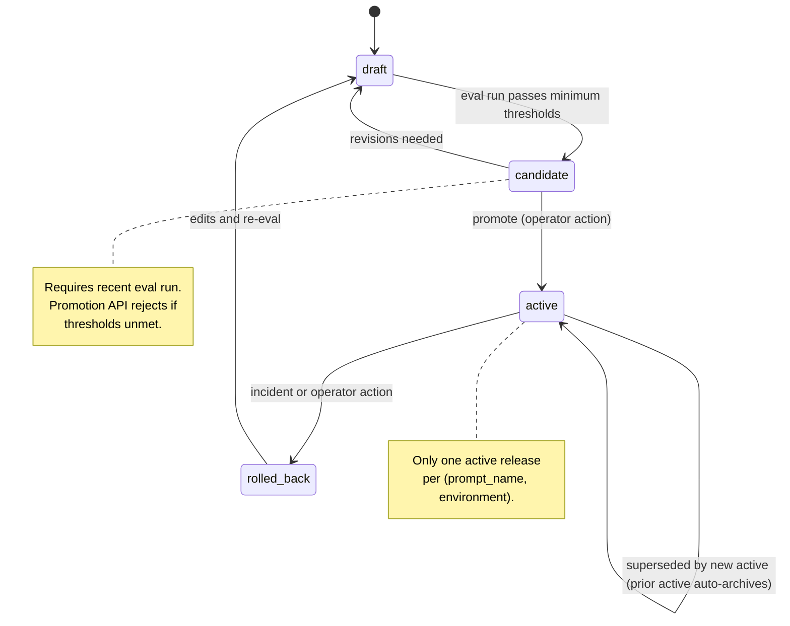

# Architecture

## Four planes

ReleasePlane decomposes into four planes per `Project_Description.txt > 3.4 High-Level Architecture`.

- **Control plane.** Stores versioned prompt definitions, prompt versions, model configs, policy bundles, and releases. Owns the release state machine. FastAPI + Postgres.
- **Execution plane.** Receives application requests, resolves the active release, calls the configured provider via the adapter Protocol, applies pre and post policies, emits traces. FastAPI gateway.
- **Ingestion.** Eval datasets (PDF generator + ground-truth JSON), eval runs, eval results. Postgres for metadata; MinIO for raw artifacts.
- **Observability.** OTel collector, Jaeger for traces, Prometheus + Grafana for metrics. `releaseplane.release_id` stamped on every span.

## Request flow


## Release lifecycle



The `canary` state is reserved in the data model (`releases.stage` enum includes it) but no traffic-split logic is wired at v1.

## Data model (control plane)

```
prompt_definitions    (id, name, team, use_case, created_at)
prompt_versions       (id, prompt_id, version, system_prompt, developer_prompt,
                       variables_schema_json, output_schema_json, tool_schema_json,
                       status, checksum, created_by, created_at)
model_configs         (id, provider, model_name, model_version_pin,
                       temperature, max_tokens, timeout_ms, tool_mode, active)
policy_bundles        (id, name, version, rules_json, severity_mode)
releases              (id, prompt_version_id, model_config_id, policy_bundle_id,
                       stage, rollout_percent, created_at, activated_at, archived_at)
```

## Data model (ingestion / eval)

```
eval_datasets         (id, name, domain, source, row_count, generator_seed)
eval_cases            (id, dataset_id, input_path, expected_json, tier, metadata_json)
eval_runs             (id, release_id, dataset_id, started_at, finished_at, status)
eval_results          (id, run_id, case_id, metric_name, metric_value, pass_fail, notes)
policy_events         (id, request_id, rule_id, outcome, detail_json, created_at)
```

## Adapter Protocol

```python
class LLMProvider(Protocol):
    async def generate_structured(
        self,
        *,
        prompt_version: PromptVersion,
        variables: dict[str, Any],
        model_config: ModelConfig,
        schema: type[BaseModel],
    ) -> StructuredResponse: ...
```

The schema parameter is a Pydantic v2 model class. The `ClaudeProvider` implementation uses Claude's tool-use path so JSON schema compliance is guaranteed at the provider level, not post-hoc validated.

## Key tradeoffs

- Pydantic v2 as single source of truth for variable and output schemas. Auto-generates JSON Schema for both prompt placeholders and structured-output contracts. Trade: binds the SDK to Python at v1; a future TypeScript SDK would need to re-export the JSON Schema or regenerate from a shared spec. Tracked as Unresolved Disagreement U1 in the Phase 0 council transcript.
- Docker Compose, not Kubernetes, at v1. The user's strongest demonstrated discipline is Compose; Kubernetes would inflate the runbook before any failure mode justifies it.
- MinIO, not S3, for raw artifacts at v1. API-compatible, cheaper to demo, no cloud credentials in the demo URL.
- No LLM-as-judge at v1. All three eval metrics are deterministic. The KB entry `[system_design] Beyond-LLM Optimization Stack ... Evaluation Axes (Stanford CS230)` names this as the cheapest viable axis: objective + component + quantitative.
- Single active release per (prompt_name, environment). Concurrent A/B traffic-splitting is deferred; it requires the `canary` state to be wired and a rollout-percent enforcement step in the gateway.

## What we are not building (and why)

See `docs/SCOPE.md` for the explicit out-of-scope list. Two items worth naming here:

- No agentic loops. The prompt is the document plus the schema. The KB entry `[system_design] Agentic Patterns` warns against agents-by-default; ReleasePlane's value is platform discipline, not multi-step reasoning.
- No retrieval. AP invoice extraction at v1 uses no external knowledge base. Re-evaluate when a future feature adds vendor-rule lookup or historical-pattern matching.
