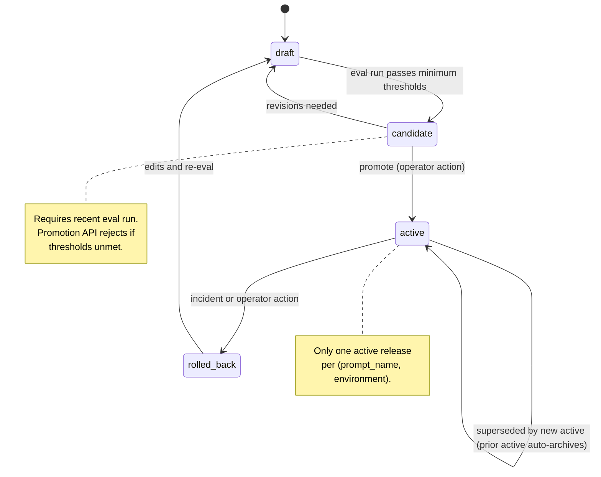

# Architecture

## Four planes

ReleasePlane decomposes into four planes per `Project_Description.txt > 3.4 High-Level Architecture`.

- **Control plane.** Stores versioned prompt definitions, prompt versions, model configs, policy bundles, and releases. Owns the release state machine. FastAPI + Postgres.
- **Execution plane.** Receives application requests, resolves the active release, calls the configured provider via the adapter Protocol, applies pre and post policies, emits traces. FastAPI gateway.
- **Ingestion.** Eval datasets (PDF generator + ground-truth JSON), eval runs, eval results. Postgres for metadata; MinIO for raw artifacts.
- **Observability.** OTel collector, Jaeger for traces, Prometheus + Grafana for metrics. `releaseplane.release_id` stamped on every span.

## Request flow


## Release lifecycle



The `canary` state is reserved in the data model (`releases.stage` enum includes it) but no traffic-split logic is wired at v1.

### Promotion (as built)

`POST /releases/{id}/promote` advances a release one hop along the forward path
(draft to candidate to active). Each call enforces the structural rules: a legal
forward transition must exist (promoting a release already at active, or at
rolled_back or canary, is rejected with 409), the release must reference a valid
model config, and the reference bundle stays immutable so only the stage moves.
Entering active stamps `activated_at` and archives the prior active release for
the same prompt.

The eval gate from `docs/EVALUATION.md` is a single seam, `eval_gate_ok`, that
the promote endpoint calls. The eval runner is Phase 4, so in Phase 2 the gate is
off by default (the `EVAL_GATE_ENFORCED` setting) and returns a bypass result;
when enforced it blocks with a clear reason. Phase 4 fills only that function
body (look up the most recent eval run, require a passing status within the
staleness window, and enforce the Tier-1 and Tier-2 thresholds) without changing
the state machine or the endpoint. The backward transitions in the diagram
(candidate to draft, active to rolled_back, rolled_back to draft) are modeled in
the transition table for a future demotion or rollback endpoint; the Phase 2
promote endpoint walks the forward path only.

## Data model (control plane)

```
prompt_definitions    (id, name, team, use_case, created_at)
prompt_versions       (id, prompt_id, version, system_prompt, developer_prompt,
                       variables_schema_json, output_schema_json, tool_schema_json,
                       status, checksum, created_by, created_at)
model_configs         (id, name, provider, model_name, model_version_pin,
                       temperature, max_tokens, timeout_ms, tool_mode, active,
                       cost_per_mtok_input_usd, cost_per_mtok_output_usd)
policy_bundles        (id, name, version, rules_json, severity_mode)
releases              (id, prompt_version_id, model_config_id, policy_bundle_id,
                       stage, rollout_percent, created_at, activated_at, archived_at)
```

### As built (Phase 2)

Phase 2 realizes these tables as SQLAlchemy 2.0 models with an Alembic migration.
Notes on the realized shapes:

- Primary keys are UUIDs (`gen_random_uuid()` server default). `releases.id` is
  the audit key stamped on every span as `releaseplane.release_id`.
- `prompt_versions.checksum` is a sha256 over a canonical JSON encoding of the
  system prompt, developer prompt, and the three schema documents, computed once
  on create. The `*_schema_json` columns and `policy_bundles.rules_json` are
  Postgres JSONB.
- `releases.stage` is a Postgres enum (`release_stage`) with values draft,
  candidate, active, rolled_back, canary.
- `model_configs` carries three columns beyond the original sketch: `name`,
  `cost_per_mtok_input_usd`, and `cost_per_mtok_output_usd`. The seed file
  `infra/model_configs/v1_default.yaml` and the cost probe both need them, so
  they are stored rather than dropped on load.
- Uniqueness: `prompt_definitions.name`, `(prompt_id, version)` on
  `prompt_versions`, `(name, version)` on `policy_bundles`, and
  `model_configs.name`.
- The "one active release per (prompt_name, environment)" rule has no
  `environment` column in the locked table, so Phase 2 enforces one active
  release per prompt. The locked `releases` table also has no `prompt_id`, so the
  promote service resolves the prompt through the prompt version and stamps
  `archived_at` on the prior active release. A per-environment dimension waits on
  an `environment` column being added.

## Data model (ingestion / eval)

```
eval_datasets         (id, name, domain, source, row_count, generator_seed)
eval_cases            (id, dataset_id, input_path, expected_json, tier, metadata_json)
eval_runs             (id, release_id, dataset_id, started_at, finished_at, status)
eval_results          (id, run_id, case_id, metric_name, metric_value, pass_fail, notes)
policy_events         (id, request_id, rule_id, outcome, detail_json, created_at)
```

## Migrations

Alembic drives the schema. The async engine cannot run the migration context
directly, so `control-plane/alembic/env.py` opens an async connection and runs
the migrations through `connection.run_sync`. The database URL and the
secret-file password resolve the same way the app resolves them, so the commands
need no configuration beyond `DATABASE_URL` (and `DATABASE_PASSWORD_FILE` when
the password comes from a mounted secret).

Run from the `control-plane` directory:

```
uv run alembic upgrade head     # create the five tables and the release_stage enum
uv run alembic downgrade base   # drop them cleanly, including the enum type
```

The initial migration creates and drops the `release_stage` enum explicitly, so
`downgrade base` leaves no orphaned type behind. CI runs the integration tests
against a Postgres service; the test schema is built from the same models.

## Adapter Protocol

```python
class LLMProvider(Protocol):
    async def generate_structured(
        self,
        *,
        prompt_version: PromptVersion,
        variables: dict[str, Any],
        model_config: ModelConfig,
        schema: type[BaseModel],
    ) -> StructuredResponse: ...
```

The schema parameter is a Pydantic v2 model class. The `ClaudeProvider` implementation uses Claude's tool-use path so JSON schema compliance is guaranteed at the provider level, not post-hoc validated.

## Key tradeoffs

- Pydantic v2 as single source of truth for variable and output schemas. Auto-generates JSON Schema for both prompt placeholders and structured-output contracts. Trade: binds the SDK to Python at v1; a future TypeScript SDK would need to re-export the JSON Schema or regenerate from a shared spec. Tracked as Unresolved Disagreement U1 in the Phase 0 council transcript.
- Docker Compose, not Kubernetes, at v1. The user's strongest demonstrated discipline is Compose; Kubernetes would inflate the runbook before any failure mode justifies it.
- MinIO, not S3, for raw artifacts at v1. API-compatible, cheaper to demo, no cloud credentials in the demo URL.
- No LLM-as-judge at v1. All three eval metrics are deterministic. The KB entry `[system_design] Beyond-LLM Optimization Stack ... Evaluation Axes (Stanford CS230)` names this as the cheapest viable axis: objective + component + quantitative.
- Single active release per (prompt_name, environment). Concurrent A/B traffic-splitting is deferred; it requires the `canary` state to be wired and a rollout-percent enforcement step in the gateway.

## What we are not building (and why)

See `docs/SCOPE.md` for the explicit out-of-scope list. Two items worth naming here:

- No agentic loops. The prompt is the document plus the schema. The KB entry `[system_design] Agentic Patterns` warns against agents-by-default; ReleasePlane's value is platform discipline, not multi-step reasoning.
- No retrieval. AP invoice extraction at v1 uses no external knowledge base. Re-evaluate when a future feature adds vendor-rule lookup or historical-pattern matching.
